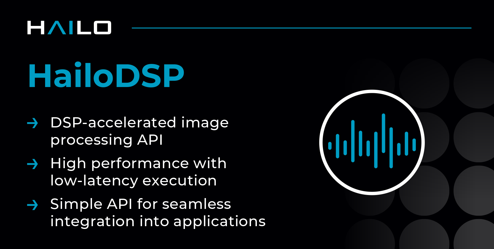

# HailoDSP

    

## Introduction

HailoDSP is a high-performance runtime library that provides a set of APIs for running DSP-accelerated image processing operations.

## Usage

See [**hailo.ai developer zone documentation**](https://hailo.ai/developer-zone/) (registration is required for full documentation access).

## Licenses

HailoDSP is distributed under the MIT license

## Contact

Contact information and support is available at [**hailo.ai**](https://hailo.ai/contact-us/).
